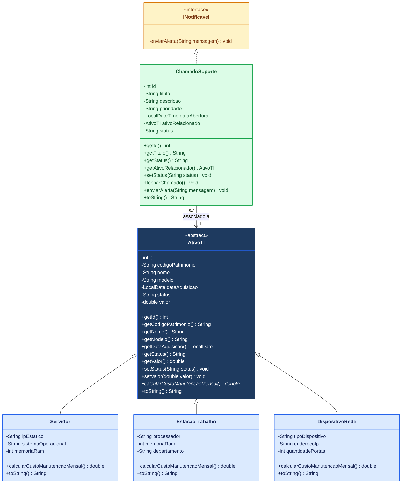
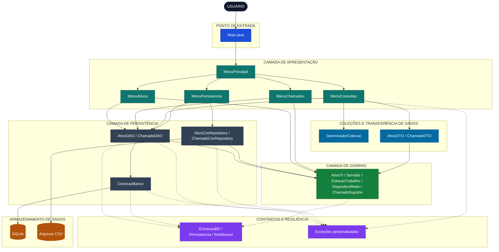
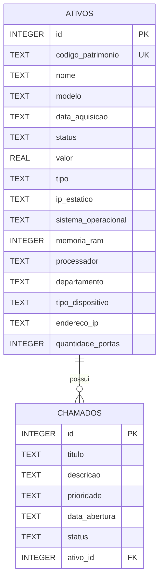

# TechLab Inventory & Service Desk

<p align="center">
  <strong>Sistema de Gerenciamento de Ativos de TI e Chamados de Suporte</strong>
</p>

<p align="center">
  Projeto Acadêmico | Análise e Desenvolvimento de Sistemas
  <br>
  Faculdade Senac Ceará — 2026.2
</p>


---

## Sumário

- [1. Sobre o projeto](#1-sobre-o-projeto)
- [2. Contexto acadêmico](#2-contexto-acadêmico)
- [3. Objetivos](#3-objetivos)
- [4. Funcionalidades](#4-funcionalidades)
- [5. Tecnologias utilizadas](#5-tecnologias-utilizadas)
- [6. Conceitos de programação orientada a objetos](#6-conceitos-de-programação-orientada-a-objetos)
- [7. Arquitetura do sistema](#7-arquitetura-do-sistema)
- [8. Estrutura do repositório](#8-estrutura-do-repositório)
- [9. Banco de dados](#9-banco-de-dados)
- [10. Segurança e integridade dos dados](#10-segurança-e-integridade-dos-dados)
- [11. Pré-requisitos](#11-pré-requisitos)
- [12. Instalação e execução](#12-instalação-e-execução)
- [13. Interface do sistema](#13-interface-do-sistema)
- [14. Testes automatizados](#14-testes-automatizados)
- [15. Persistência e arquivos CSV](#15-persistência-e-arquivos-csv)
- [16. Documentação técnica](#16-documentação-técnica)
- [17. Versionamento](#17-versionamento)
- [18. Limitações e decisões de projeto](#18-limitações-e-decisões-de-projeto)
- [19. Autoria](#19-autoria)
- [20. Considerações finais](#20-considerações-finais)

---

## 1. Sobre o projeto

O **TechLab Inventory & Service Desk** é uma aplicação
desenvolvida em Java para o gerenciamento de ativos de
Tecnologia da Informação e chamados de suporte técnico.

O sistema permite cadastrar, consultar, atualizar e excluir
equipamentos, gerenciar chamados técnicos, realizar buscas,
aplicar filtros, ordenar registros e exportar informações
para arquivos CSV.

A aplicação utiliza uma arquitetura organizada em camadas,
persistência de dados com SQLite e uma interface interativa
executada pelo terminal.

### Principais características

| Característica | Descrição |
|---|---|
| Modelagem orientada a objetos | Classes abstratas, herança e polimorfismo |
| Arquitetura modular | Separação de responsabilidades |
| Persistência relacional | SQLite integrado por JDBC |
| Persistência complementar | Exportação e leitura de CSV |
| Segurança | Consultas parametrizadas e validações |
| Testes automatizados | 8 classes e 126 verificações |
| Controle de versão | Git e GitHub |

---

## 2. Contexto acadêmico

| Informação | Descrição |
|---|---|
| Instituição | Faculdade Senac Ceará |
| Curso | Análise e Desenvolvimento de Sistemas |
| Disciplina | Programação Orientada a Objetos e Persistência |
| Semestre | 2026.2 |
| Projeto | TechLab Inventory & Service Desk |
| Linguagem | Java |
| Desenvolvedora | Janaina Aparecida Chiorato |

O projeto foi desenvolvido de forma incremental durante
a disciplina, aplicando conceitos de programação orientada
a objetos, abstração, contratos, tratamento de exceções,
coleções genéricas e persistência de dados.

O desenvolvimento foi versionado utilizando Git e GitHub,
preservando o histórico de evolução da aplicação.

---

## 3. Objetivos

### Objetivo geral

Desenvolver uma aplicação orientada a objetos para
gerenciamento de ativos de TI e chamados de suporte,
integrando modelagem de domínio, persistência de dados
e tratamento de exceções.

### Objetivos específicos

- Aplicar os princípios da programação orientada a objetos.
- Implementar uma arquitetura organizada em camadas.
- Utilizar interfaces para definição de contratos.
- Implementar exceções personalizadas.
- Trabalhar com coleções genéricas e DTOs.
- Desenvolver operações completas de CRUD.
- Implementar persistência em arquivos CSV.
- Integrar a aplicação com um banco de dados relacional.
- Garantir a integridade referencial dos registros.
- Aplicar boas práticas de segurança nas consultas SQL.
- Utilizar Git e GitHub para controle de versão.
- Validar o funcionamento por meio de testes automatizados.

---

## 4. Funcionalidades

### 4.1. Gerenciamento de ativos

- [x] Cadastro de equipamentos.
- [x] Listagem de ativos.
- [x] Busca por ID.
- [x] Busca por código de patrimônio.
- [x] Atualização de equipamentos.
- [x] Exclusão de equipamentos.
- [x] Validação dos atributos.
- [x] Cálculo do custo mensal de manutenção.
- [x] Controle de status dos ativos.

#### Tipos de equipamentos

| Tipo | Características específicas |
|---|---|
| Servidor | IP estático, sistema operacional e memória RAM |
| Estação de trabalho | Processador, memória RAM e departamento |
| Dispositivo de rede | Tipo de dispositivo, endereço IP e quantidade de portas |

#### Status dos ativos

| Status | Descrição |
|---|---|
| ATIVO | Equipamento em utilização |
| INATIVO | Equipamento fora de utilização |
| EM_MANUTENCAO | Equipamento em manutenção |
| DESCARTADO | Equipamento retirado de operação |

### 4.2. Gerenciamento de chamados

- [x] Abertura de chamados.
- [x] Listagem de chamados.
- [x] Busca por ID.
- [x] Consulta por equipamento.
- [x] Filtro por status.
- [x] Filtro por prioridade.
- [x] Atualização de chamados.
- [x] Encerramento de chamados.
- [x] Exclusão de chamados.
- [x] Associação com equipamentos cadastrados.
- [x] Emissão de alertas pelo terminal.

#### Prioridades

| Prioridade | Classificação |
|---|---|
| BAIXA | Baixa prioridade |
| MEDIA | Prioridade intermediária |
| ALTA | Alta prioridade |
| CRITICA | Prioridade crítica |

#### Status dos chamados

| Status | Descrição |
|---|---|
| ABERTO | Chamado registrado |
| EM_ATENDIMENTO | Chamado em atendimento |
| RESOLVIDO | Problema solucionado |
| FECHADO | Chamado encerrado |

### 4.3. Consultas e ordenação

- [x] Filtragem de ativos por tipo.
- [x] Filtragem de ativos por status.
- [x] Busca de ativos por nome.
- [x] Ordenação alfabética.
- [x] Ordenação por valor crescente.
- [x] Ordenação por valor decrescente.
- [x] Utilização de coleções genéricas.
- [x] Utilização de DTOs.

### 4.4. Persistência em CSV

- [x] Exportação de ativos.
- [x] Exportação de chamados.
- [x] Exportação conjunta de ativos e chamados.
- [x] Leitura de ativos armazenados em CSV.
- [x] Leitura de chamados armazenados em CSV.
- [x] Validação de registros durante a leitura.
- [x] Verificação de vínculos entre chamados e ativos.

---

## 5. Tecnologias utilizadas

| Tecnologia | Finalidade |
|---|---|
| Java | Linguagem de programação |
| SQLite | Banco de dados relacional |
| JDBC | Comunicação entre Java e banco de dados |
| SQLite JDBC | Driver de conexão com SQLite |
| SQL | Manipulação e consulta de dados |
| SLF4J | Infraestrutura de logging |
| CSV | Persistência complementar em arquivos |
| Git | Controle de versão |
| GitHub | Hospedagem e versionamento do projeto |
| GitHub Codespaces | Ambiente de desenvolvimento |
| Visual Studio Code | Editor de código |
| Markdown | Documentação técnica |
| Mermaid | Diagramas de arquitetura e modelagem |

---

## 6. Conceitos de programação orientada a objetos

### 6.1. Encapsulamento

Os atributos das classes de domínio são privados e
acessados por métodos getters e setters.

As validações são realizadas nas classes de domínio,
contribuindo para a consistência dos objetos.

### 6.2. Abstração

A classe abstrata `AtivoTI` representa as características
comuns dos equipamentos de tecnologia da informação.

### 6.3. Herança

As classes abaixo estendem a classe abstrata `AtivoTI`:

- `Servidor`
- `EstacaoTrabalho`
- `DispositivoRede`

Cada classe possui atributos e comportamentos específicos.

### 6.4. Polimorfismo

O método `calcularCustoManutencaoMensal()` possui
implementações específicas para cada tipo de equipamento.

Isso permite trabalhar com diferentes tipos de ativos
por meio de uma referência comum da classe `AtivoTI`.

### 6.5. Interfaces

| Interface | Responsabilidade |
|---|---|
| IConexaoBD | Define o contrato de conexão com o banco |
| INotificavel | Define o contrato de emissão de alertas |
| IPersistencia<T> | Define o contrato genérico de persistência |

### 6.6. Exceções personalizadas

| Exceção | Responsabilidade |
|---|---|
| EquipamentoNaoEncontradoException | Trata a ausência de equipamentos |
| FalhaConexaoBDException | Representa falhas de conexão com o banco |

### 6.7. Generics

A classe `GerenciadorColecao<T>` permite trabalhar com
coleções de diferentes tipos, oferecendo operações de
busca, filtragem, ordenação e gerenciamento de registros.

### 6.8. DTOs

Os objetos de transferência de dados representam
informações de ativos e chamados.

- `AtivoDTO`
- `ChamadoDTO`

### 6.9. Diagrama de classes UML

O diagrama apresenta as principais classes do domínio,
seus atributos, comportamentos, relações de herança
e implementação de interfaces.



> O diagrama apresenta os principais métodos das classes,
> omitindo alguns getters, setters e construtores para
> facilitar a leitura.

### 6.10. Interpretação do diagrama

| Relacionamento | Aplicação |
|---|---|
| Herança | Servidor, EstacaoTrabalho e DispositivoRede estendem AtivoTI |
| Abstração | AtivoTI define características e comportamentos comuns |
| Realização | ChamadoSuporte implementa INotificavel |
| Associação | Cada chamado está vinculado a um ativo |
| Multiplicidade | Um ativo pode possuir zero ou vários chamados |
| Polimorfismo | Cada tipo de ativo possui seu cálculo de manutenção |

---

## 7. Arquitetura do sistema

O projeto utiliza uma arquitetura organizada em camadas,
com separação de responsabilidades entre os componentes.

### 7.1. Responsabilidades das camadas

| Camada | Responsabilidade |
|---|---|
| View | Interação com o usuário pelo terminal |
| Model | Entidades, atributos e regras de domínio |
| Interfaces | Contratos e abstrações |
| Exceptions | Tratamento de exceções personalizadas |
| DAO | Operações de persistência no SQLite |
| DTO | Transferência de dados |
| Service | Gerenciamento de coleções genéricas |
| Persistence | Leitura e gravação de arquivos CSV |
| Tests | Validação automatizada dos componentes |

### 7.2. Diagrama da arquitetura em camadas



### 7.3. Fluxo de funcionamento

1. O usuário interage com o menu principal.
2. Os menus recebem e validam as entradas.
3. As classes de domínio representam os objetos do sistema.
4. Os DAOs executam as operações de persistência relacional.
5. A classe ConexaoBanco estabelece a conexão JDBC.
6. O SQLite armazena os registros.
7. As coleções genéricas permitem buscas, filtros e ordenações.
8. Os repositórios CSV permitem exportação e leitura de dados.
9. As exceções personalizadas auxiliam no tratamento de falhas.

---

## 8. Estrutura do repositório

```text
POO_e_Persistencia_2026.2/
│
├── dao/
│   ├── AtivoDAO.java
│   ├── ChamadoDAO.java
│   └── ConexaoBanco.java
│
├── docs/
│   ├── arquitetura.md
│   ├── modelagem-banco-dados.md
│   └── modelagem-dominio.md
│
├── dto/
│   ├── AtivoDTO.java
│   └── ChamadoDTO.java
│
├── exceptions/
│   ├── EquipamentoNaoEncontradoException.java
│   └── FalhaConexaoBDException.java
│
├── interfaces/
│   ├── IConexaoBD.java
│   ├── INotificavel.java
│   └── IPersistencia.java
│
├── lib/
│   ├── slf4j-api.jar
│   ├── slf4j-simple.jar
│   └── sqlite-jdbc.jar
│
├── model/
│   ├── AtivoTI.java
│   ├── ChamadoSuporte.java
│   ├── DispositivoRede.java
│   ├── EstacaoTrabalho.java
│   └── Servidor.java
│
├── persistence/
│   ├── AtivoCsvRepository.java
│   ├── ChamadoCsvRepository.java
│   └── CsvUtil.java
│
├── service/
│   └── GerenciadorColecao.java
│
├── tests/
│   ├── TesteAtivoDAO.java
│   ├── TesteChamadoDAO.java
│   ├── TesteColecoes.java
│   ├── TesteContratosResiliencia.java
│   ├── TesteDTOs.java
│   ├── TesteIntegridadeSeguranca.java
│   ├── TesteModelagemDominio.java
│   └── TestePersistenciaCsv.java
│
├── view/
│   ├── MenuAtivos.java
│   ├── MenuChamados.java
│   ├── MenuConsultas.java
│   ├── MenuPersistencia.java
│   └── MenuPrincipal.java
│
├── .gitignore
├── banco.sql
├── Main.java
└── README.md
```

---

## 9. Banco de dados

O sistema utiliza SQLite como banco de dados relacional.

A estrutura é definida no arquivo `banco.sql`, que contém
as instruções de criação das tabelas, restrições,
relacionamentos, índices e triggers.

### 9.1. Tabelas principais

| Tabela | Responsabilidade |
|---|---|
| ativos | Armazenamento dos equipamentos de TI |
| chamados | Armazenamento dos chamados de suporte |

### 9.2. Estratégia de modelagem

A persistência dos diferentes tipos de ativos utiliza
uma tabela única com um atributo discriminador chamado
`tipo`.

Essa estratégia é conhecida como Single Table Inheritance.

Os atributos específicos de servidores, estações de
trabalho e dispositivos de rede são armazenados na
tabela `ativos`, respeitando as restrições definidas
para cada tipo de equipamento.

### 9.3. Diagrama entidade-relacionamento (DER)



### 9.4. Cardinalidade

| Entidade | Cardinalidade | Descrição |
|---|---|---|
| Ativos | 1 | Equipamento cadastrado |
| Chamados | 0..N | Um ativo pode possuir nenhum ou vários chamados |

Cada chamado está obrigatoriamente associado a um ativo.

### 9.5. Chaves e relacionamentos

| Elemento | Descrição |
|---|---|
| ativos.id | Chave primária dos ativos |
| ativos.codigo_patrimonio | Código de patrimônio único |
| chamados.id | Chave primária dos chamados |
| chamados.ativo_id | Chave estrangeira para ativos.id |

### 9.6. Integridade referencial

O relacionamento é protegido por chave estrangeira,
impedindo a existência de chamados vinculados a
equipamentos inexistentes.

A exclusão de equipamentos com chamados vinculados
também é bloqueada.

### 9.7. Tipos de ativos armazenados

| Discriminador | Classe correspondente |
|---|---|
| SERVIDOR | Servidor |
| ESTACAO_TRABALHO | EstacaoTrabalho |
| DISPOSITIVO_REDE | DispositivoRede |

---

## 10. Segurança e integridade dos dados

O projeto utiliza os seguintes mecanismos:

- PreparedStatement para parametrização das consultas SQL.
- Proteção contra SQL Injection nas operações dos DAOs.
- Validação de atributos nas classes de domínio.
- Restrições CHECK no banco de dados.
- Chaves primárias.
- Chaves estrangeiras.
- Restrições de unicidade.
- Restrições NOT NULL.
- Triggers para validação do status dos ativos.
- Tratamento de exceções.
- Fechamento de recursos com try-with-resources.
- Controle de arquivos locais por meio do .gitignore.

### Mecanismos de proteção

| Mecanismo | Finalidade |
|---|---|
| PreparedStatement | Evitar concatenação de entradas nas consultas SQL |
| PRIMARY KEY | Identificar registros de forma única |
| FOREIGN KEY | Preservar relacionamentos entre registros |
| UNIQUE | Impedir duplicidade de patrimônio |
| CHECK | Restringir valores inválidos |
| NOT NULL | Impedir ausência de valores obrigatórios |
| Triggers | Reforçar a validação do status dos ativos |
| Try-with-resources | Garantir o fechamento dos recursos utilizados |

---

## 11. Pré-requisitos

Para executar o projeto, é necessário possuir:

- Java Development Kit (JDK).
- Git.
- SQLite CLI.
- Terminal Bash ou ambiente compatível.

As bibliotecas JDBC e SLF4J necessárias estão
disponíveis na pasta `lib/`.

Não é necessário instalar Maven ou Gradle.

### Verificar as ferramentas instaladas

```bash
java -version
javac -version
git --version
sqlite3 --version
```

Os comandos apresentados neste documento foram
preparados para execução em ambiente Linux,
incluindo o GitHub Codespaces.

---

## 12. Instalação e execução

### 12.1. Clonar o repositório

```bash
git clone https://github.com/Janaina-Chiorato/POO_e_Persistencia_2026.2.git
```

### 12.2. Acessar o diretório

```bash
cd POO_e_Persistencia_2026.2
```

### 12.3. Inicializar o banco de dados

```bash
sqlite3 -bail techlab_final.db < banco.sql
```

O comando cria a estrutura necessária para
o funcionamento da aplicação.

O banco de dados local não é versionado no GitHub.

### 12.4. Compilar o projeto

```bash
javac -encoding UTF-8 -cp ".:lib/*" interfaces/*.java exceptions/*.java model/*.java dao/*.java dto/*.java service/*.java persistence/*.java view/*.java tests/*.java Main.java
```

### 12.5. Executar a aplicação

```bash
java --enable-native-access=ALL-UNNAMED -cp ".:lib/*" Main
```

---

## 13. Interface do sistema

Após a execução, será apresentado o menu principal:

```text
============================================
    TECHLAB INVENTORY & SERVICE DESK
============================================

  1. Gerenciamento de Ativos
  2. Gerenciamento de Chamados
  3. Consultas e Ordenacao
  4. Persistencia e Backup CSV
  0. Sair

============================================
```

### Fluxo básico de utilização

1. Cadastrar um equipamento.
2. Consultar os equipamentos disponíveis.
3. Abrir um chamado associado a um equipamento.
4. Atualizar o status do chamado.
5. Encerrar o chamado.
6. Consultar os registros.
7. Exportar os dados para arquivos CSV.

---

## 14. Testes automatizados

O projeto possui oito classes de testes automatizados,
desenvolvidas para validar os principais componentes
da aplicação.

### 14.1. Distribuição dos testes

| Classe de teste | Verificações |
|---|---:|
| TesteModelagemDominio | 9 |
| TesteContratosResiliencia | 5 |
| TesteColecoes | 16 |
| TesteDTOs | 8 |
| TestePersistenciaCsv | 18 |
| TesteAtivoDAO | 25 |
| TesteChamadoDAO | 31 |
| TesteIntegridadeSeguranca | 14 |
| **Total** | **126** |

### 14.2. Executar todos os testes

Após compilar o projeto, execute:

```bash
for teste in TesteModelagemDominio TesteContratosResiliencia TesteColecoes TesteDTOs TestePersistenciaCsv TesteAtivoDAO TesteChamadoDAO TesteIntegridadeSeguranca; do
    echo "========== $teste =========="
    java --enable-native-access=ALL-UNNAMED -cp ".:lib/*" tests.$teste || break
done
```

### 14.3. Áreas verificadas

- Modelagem de domínio.
- Validação de atributos.
- Herança e polimorfismo.
- Contratos e exceções.
- Coleções genéricas.
- DTOs.
- Persistência em CSV.
- CRUD de ativos.
- CRUD de chamados.
- Integridade referencial.
- Segurança das operações SQL.

### 14.4. Resultado dos testes

| Indicador | Resultado registrado |
|---|---:|
| Classes de testes | 8 |
| Verificações executadas | 126 |
| Verificações aprovadas | 126 |
| Verificações reprovadas | 0 |
| Aproveitamento nas verificações executadas | 100% |

Os resultados representam as verificações implementadas
e executadas, não uma medição de cobertura integral
do código-fonte.

---

## 15. Persistência e arquivos CSV

Os arquivos exportados pelo sistema são armazenados
no diretório `dados/`.

```text
dados/
├── ativos.csv
└── chamados.csv
```

O formato CSV utiliza codificação UTF-8 e ponto e
vírgula como separador de campos.

A exportação permite consultar os registros fora
do banco de dados relacional.

Os arquivos gerados são ignorados pelo Git para
evitar o versionamento de dados locais.

A exportação conjunta não constitui uma transação
atômica entre os dois arquivos.

A leitura dos arquivos CSV permite consultar os
registros exportados, mas não realiza restauração
automática no banco SQLite.

---

## 16. Documentação técnica

Os diagramas principais estão incorporados neste README,
nas seções correspondentes aos conceitos apresentados.

A documentação complementar está organizada na pasta
`docs/`, permitindo consultar os detalhes técnicos
de cada componente.

### Documentos complementares

| Documento | Conteúdo | Acesso |
|---|---|---|
| Arquitetura do sistema | Camadas, componentes e fluxo de comunicação | [Visualizar documento](docs/arquitetura.md) |
| Modelagem de domínio | Classes, atributos, interfaces e relacionamentos | [Visualizar documento](docs/modelagem-dominio.md) |
| Modelagem do banco de dados | DER, tabelas, chaves e restrições | [Visualizar documento](docs/modelagem-banco-dados.md) |

### Acesso rápido aos diagramas

| Diagrama | Localização |
|---|---|
| Diagrama de classes UML | [Seção 6.9](#69-diagrama-de-classes-uml) |
| Arquitetura em camadas | [Seção 7.2](#72-diagrama-da-arquitetura-em-camadas) |
| Diagrama entidade-relacionamento | [Seção 9.3](#93-diagrama-entidade-relacionamento-der) |

### Código-fonte do banco de dados

A estrutura SQL completa pode ser consultada no
arquivo [banco.sql](banco.sql).

---

## 17. Versionamento

O desenvolvimento foi realizado de maneira incremental,
utilizando Git e GitHub.

O histórico de commits registra a evolução do projeto,
desde a modelagem inicial até a integração das
funcionalidades e a organização da arquitetura final.

### Padrões de commits

| Prefixo | Finalidade |
|---|---|
| feat | Implementação de funcionalidades |
| fix | Correção de comportamentos |
| refactor | Reorganização do código |
| docs | Atualização da documentação |

### Evolução do projeto

| Etapa | Desenvolvimento |
|---|---|
| 01 | Modelagem de domínio |
| 02 | Interfaces e exceções personalizadas |
| 03 | Coleções genéricas e DTOs |
| 04 | Persistência em arquivos CSV |
| 05 | Banco de dados SQLite |
| 06 | Implementação dos DAOs |
| 07 | Integração dos menus |
| 08 | Testes de integridade e segurança |
| 09 | Validação e organização do repositório |
| 10 | Documentação técnica |

---

## 18. Limitações e decisões de projeto

- A interface do sistema é executada pelo terminal.
- Os alertas são apresentados no console.
- Os custos de manutenção utilizam fórmulas demonstrativas.
- Os endereços IP são validados quanto ao preenchimento,
  sem verificação completa do formato.
- O banco de dados precisa ser inicializado antes
  da primeira execução.
- A persistência CSV é complementar ao banco SQLite.
- Os testes verificam os cenários implementados, sem
  representar cobertura integral do código.

Essas decisões mantêm o projeto alinhado ao escopo
acadêmico da disciplina.

---

## 19. Autoria

### Janaina Aparecida Chiorato

Estudante de Análise e Desenvolvimento de Sistemas.

Faculdade Senac Ceará.

Áreas de conhecimento aplicadas neste projeto:

- Desenvolvimento de software.
- Programação orientada a objetos.
- Banco de dados relacional.
- Arquitetura de software.
- Persistência de dados.
- Testes automatizados.
- Controle de versão.

[](https://github.com/Janaina-Chiorato)

---

## 20. Considerações finais

O desenvolvimento do TechLab Inventory & Service Desk
permitiu consolidar conhecimentos de programação
orientada a objetos, arquitetura de software, banco
de dados relacional, persistência em arquivos,
tratamento de exceções e controle de versão.

A aplicação integra os principais conceitos
trabalhados durante a disciplina de Programação
Orientada a Objetos e Persistência, apresentando
uma solução funcional, modular e organizada.

O projeto demonstra a aplicação prática dos
conhecimentos adquiridos durante o semestre,
integrando diferentes componentes em uma
solução de gerenciamento de ativos de TI
e chamados de suporte técnico.

---

<p align="center">
  <strong>TECHLAB INVENTORY & SERVICE DESK</strong>
  <br><br>
  Desenvolvido por Janaina Aparecida Chiorato
  <br>
  Análise e Desenvolvimento de Sistemas
  <br>
  Faculdade Senac Ceará — 2026.2
</p>